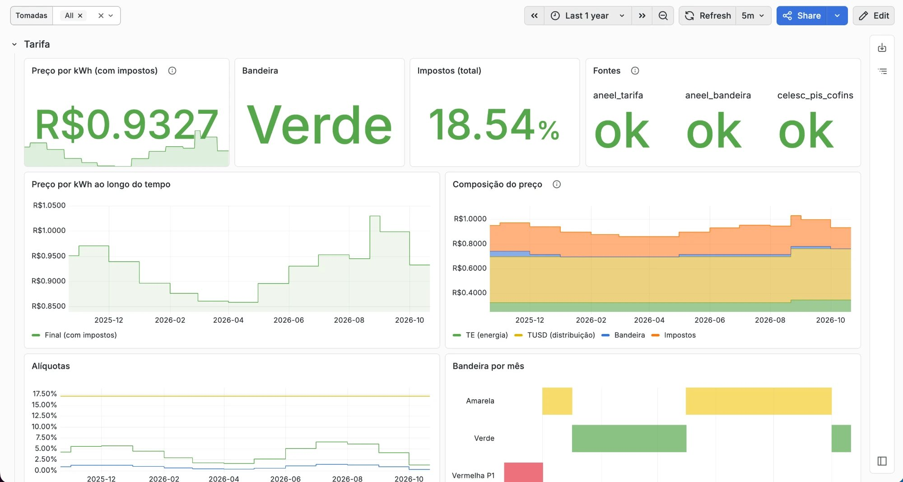

# Celesc Prometheus Exporter


A Prometheus exporter for the price of residential electricity in Brazil, with taxes, so a power meter's watts (a Tapo P110, a Shelly, a UPS) can be turned into R$ with the tariff that was actually in force at the time, instead of a number typed into a Grafana variable.

It combines:

| Part of the price | Source | Updated |
| --- | --- | --- |
| TE + TUSD (tarifa homologada) | [ANEEL open data](https://dadosabertos.aneel.gov.br/dataset/tarifas-distribuidoras-energia-eletrica) | yearly, at the distributor's reajuste |
| Bandeira tarifária | [ANEEL open data](https://dadosabertos.aneel.gov.br/dataset/bandeiras-tarifarias) | monthly |
| PIS / COFINS | [Celesc tariff page](https://www.celesc.com.br/tarifas-de-energia) (scraped), or `.env` | monthly |
| ICMS, COSIP | `.env` | rarely |

The defaults are a regular residential customer of **Celesc (Santa Catarina)**. Other distributors work through `DISTRIBUIDORA`/`SUBGRUPO`/... with PIS/COFINS set by hand, since only Celesc's page is scraped.

The final price uses the formula distributors print on the bill. Taxes are charged *por dentro*:

```
tarifa_final = (TE + TUSD + bandeira) / (1 − ICMS − PIS − COFINS)
```

## How to use

```bash
cp .env.example .env   # adjust ICMS_PERCENT and friends to match your bill
docker compose up -d
curl -s localhost:3000/metrics
```

To build from source: `docker compose -f docker-compose.yml -f docker-compose.build.yml up -d --build`, or `go run .` with Go 1.26.

### Configuration

All variables are optional; see [`.env.example`](.env.example). Invalid values stop the exporter at startup rather than silently falling back, because prices depend on them.

| Variable | Default | Meaning |
| --- | --- | --- |
| `DISTRIBUIDORA`, `SUBGRUPO`, `MODALIDADE`, `CLASSE`, `SUBCLASSE` | `CELESC`, `B1`, `Convencional`, `Residencial`, `Residencial` | Which ANEEL tariff row to use |
| `ICMS_PERCENT` | `17` | ICMS in percent (SC residential: 12 up to 150 kWh/month, 17 above) |
| `PIS_PERCENT`, `COFINS_PERCENT` | empty | Set both to pin them; leave both empty to scrape Celesc |
| `COSIP_REAIS_MES` | empty | Monthly street-lighting fee in R$ |
| `REFRESH_INTERVAL` | `6h` | How often to re-read the sources |
| `TZ` | `America/Sao_Paulo` | Which calendar month is "now" |
| `PORT` | `3000` | Listen port |

## Metrics

| Metric | Meaning |
| --- | --- |
| `energia_tarifa_final_reais_kwh` | Price per kWh with flag and taxes |
| `energia_tarifa_reais_kwh{componente="te\|tusd\|bandeira"}` | Components without taxes |
| `energia_imposto_ratio{imposto="icms\|pis\|cofins"}` | Tax rates as ratios |
| `energia_bandeira_info{bandeira="..."}` | The flag in force (always 1) |
| `energia_cosip_reais_mes` | COSIP, when configured |
| `energia_tarifa_vigencia_{inicio,fim}_timestamp_seconds`, `energia_bandeira_competencia_timestamp_seconds`, `energia_pis_cofins_referencia_timestamp_seconds` | Which period each input refers to |
| `energia_fonte_sucesso{fonte}`, `energia_fonte_ultimo_sucesso_timestamp_seconds{fonte}` | Health of each source |

A source that fails keeps its last good value and flips `energia_fonte_sucesso` to 0. Price metrics only appear once every input has been read at least once, so a cold start never exports a price built from zeros. If a month hasn't been published yet (flag, PIS/COFINS), the latest earlier one is used; the `*_timestamp_seconds` gauges show when that happens.

### Grafana / PromQL

With a Tapo P110 exporter (`tapo_power_watts`):

```promql
# R$ per hour, per device
avg_over_time(tapo_power_watts[1h]) / 1000
  * on() group_left energia_tarifa_final_reais_kwh

# R$ over the dashboard range, using the price of each moment
sum(sum_over_time((sum(tapo_power_watts) / 1000
  * on() group_left energia_tarifa_final_reais_kwh)[$__range:1m])) / 60
```

### Grafana dashboard



[`grafana/dashboard.json`](grafana/dashboard.json) can be imported in Grafana (Dashboards → New → Import) and asks for the Prometheus data source. It shows the current price, flag, taxes and source health, the price and its composition over time, the rates and a monthly flag timeline. A collapsed row prices the [Tapo P110 exporter](https://github.com/MateuxLucax/tapo-p110-prometheus-exporter)'s power readings (cost per hour, cost over the range, 30-day projection); it stays empty without that exporter.

## Backfilling past prices

Prometheus only has what it scraped, so a power history recorded before the exporter existed has no price to join against. The `backfill` subcommand reads the whole ANEEL and Celesc history once and writes the same metrics for a past period as OpenMetrics, for `promtool`:

```bash
# Same .env as the exporter, so ICMS and the tariff filter match.
# -to: when the live exporter started scraping, so the two don't overlap.
docker run --rm --env-file .env -v "$PWD:/out" ghcr.io/mateuxlucax/celesc-prometheus-exporter:latest \
  backfill -from 2025-10-21 -to 2026-10-21T12:00:00-03:00 -o /out/energia.om

# Turn it into TSDB blocks (monthly blocks; promtool's 2h default makes thousands)
docker run --rm -v "$PWD:/out" --entrypoint promtool prom/prometheus:latest \
  tsdb create-blocks-from openmetrics --max-block-duration=744h /out/energia.om /out/blocks

# Move the blocks into Prometheus' data directory; it picks them up on its own
# (or on restart) and compacts them with the rest.
mv blocks/* /path/to/prometheus/data/
```

`-job` and `-instance` (default `energia` and `celesc-prometheus-exporter:3000`) should match the scrape config so the backfilled and live series line up. Samples are written every `-step` (default 2m, at most 4m) so queries that join against them stay inside Prometheus' 5-minute lookback; one year is about 2.1M samples (~230 MB of text, ~1.5 MB of blocks, about 20 s in promtool).

Each day is priced with the tariff, flag and PIS/COFINS of that day's month. ICMS comes from `ICMS_PERCENT`, so periods with another rate (SC charged 25% before 07/2022) need separate runs. Days whose month isn't published yet are skipped, never priced with another month's numbers. The Celesc table goes back to 01/2019 and the flags to 2015.

## Security

- Standard library only: no third-party Go modules.
- Distroless `nonroot` image, no shell; the compose file adds `read_only`, `cap_drop: ALL` and `no-new-privileges`, and binds to loopback. `/metrics` is unauthenticated and serves only public data, but keep it on a trusted network anyway.
- Outbound requests are HTTPS only, with a 30 s timeout, a 2 MiB body cap, and redirects followed only on the same host.
- Upstream data is validated before export: numbers must be finite and plausible, and the only upstream string that reaches the output (the flag name) is escaped and truncated.

## License

GPL-3.0, see [LICENSE](LICENSE).
